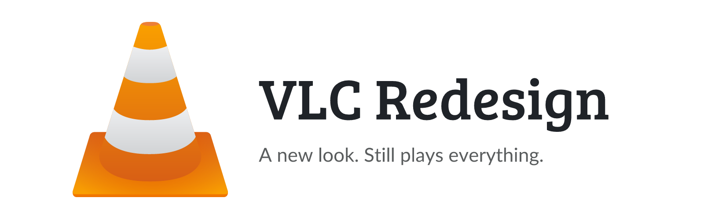
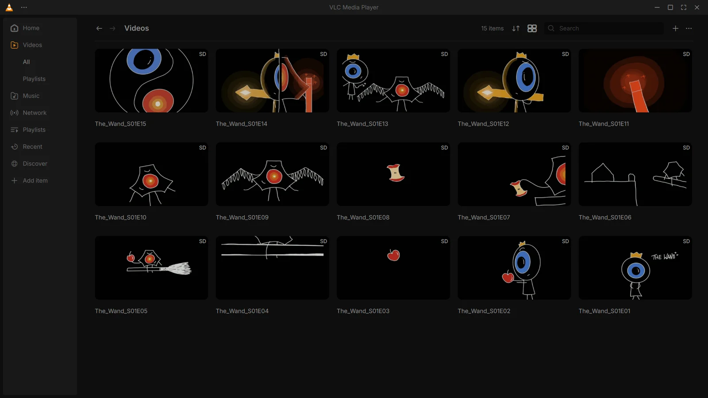
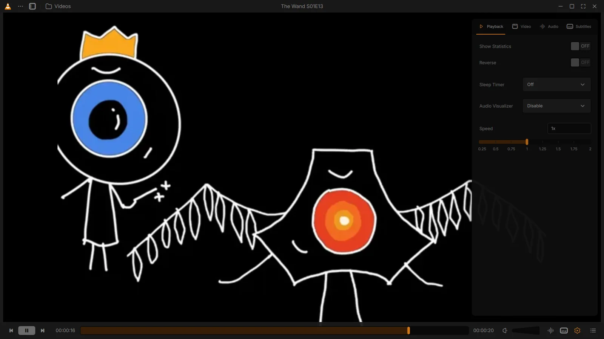
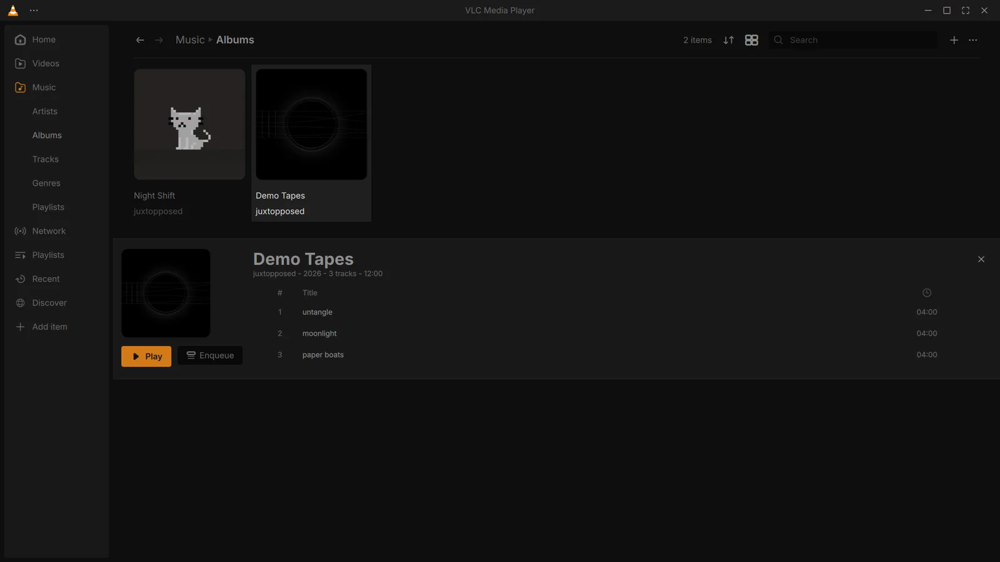
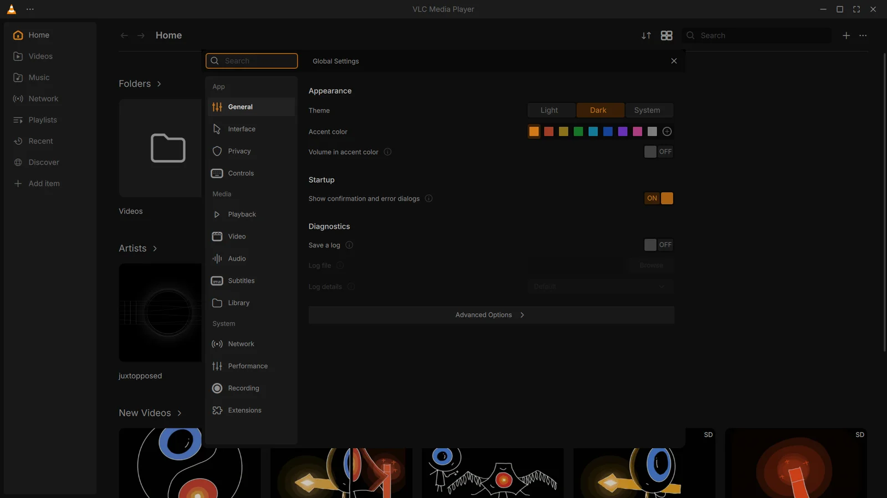
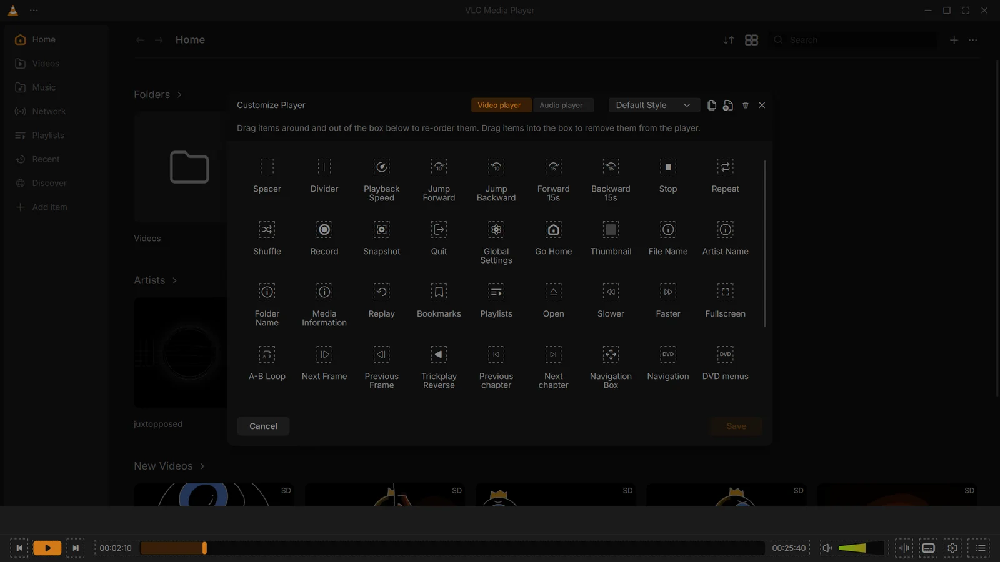
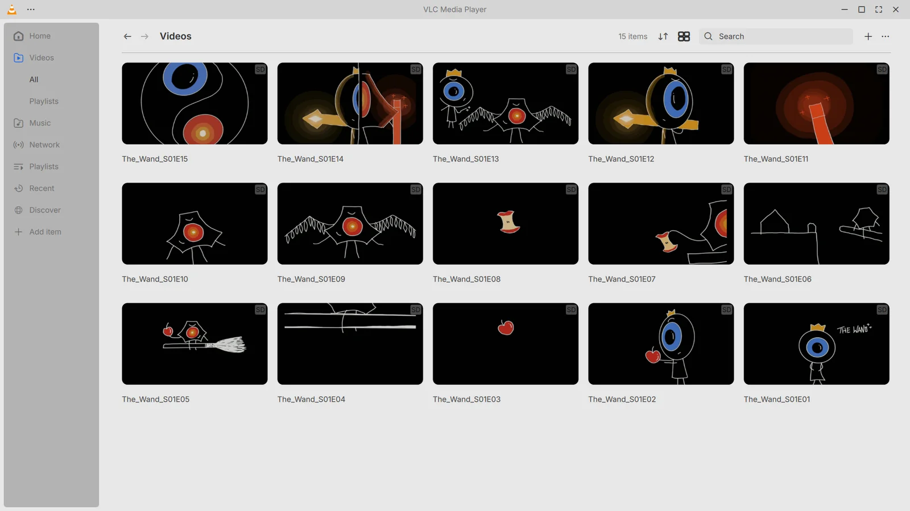
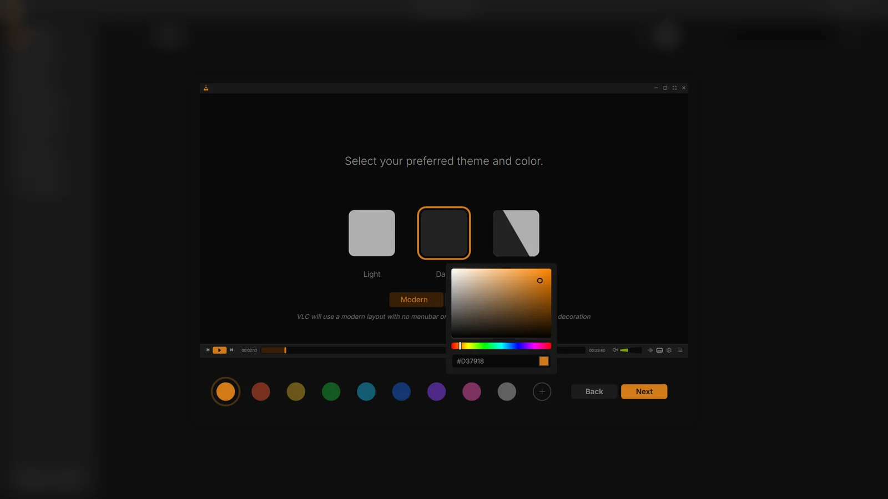

<p align="center">
  <picture>
    <source media="(prefers-color-scheme: dark)" srcset=".github/assets/vlc-redesign-banner-dark.png">
    
  </picture>
</p>

<p align="center">
  <a href="https://github.com/junkerderprovinz/vlc-redesign/releases/latest"></a>
  &nbsp;
  
  &nbsp;
  <a href="COPYING"></a>
</p>

<p align="center">
VLC 4 with the interface <a href="https://www.youtube.com/watch?v=ERFeOgqk324">Juxtopposed designed for it</a>: a new library, player, settings and first-run setup, in dark and light, with any accent colour you like. Underneath it is still VLC and plays everything VLC plays. This is an unofficial build, not made or endorsed by VideoLAN.
</p>

<!-- download-buttons: written by scripts/gen_download_buttons.py -->
<p align="center">
  <a href="https://github.com/junkerderprovinz/vlc-redesign/releases/latest"></a>
</p>
<br>
<p align="center">
  <a href="https://github.com/junkerderprovinz/vlc-redesign/releases/latest/download/vlc-redesign-windows-amd64.zip"></a><a href="https://github.com/junkerderprovinz/vlc-redesign/releases/latest/download/vlc-redesign-windows-amd64-portable.zip"></a>
  &nbsp;
  <a href="https://github.com/junkerderprovinz/vlc-redesign/releases/latest/download/vlc-redesign-linux-amd64.AppImage"></a>
  <br><sub>Always downloads the latest build</sub>
</p>
<!-- /download-buttons -->

<br>

<p align="center">
A one-knight job: I build it, keep it running, work through the issues and add what people ask for, until nothing is missing. It is free, with no accounts, no telemetry, no ads and no paid tier. No asterisk anywhere. Nothing readable ever leaves your own walls. Forged on evenings and weekends, with heart and stubbornness.
</p>

<p align="center">
If it has earned a place on your server or computer, toss a coin to your knight: it helps cover the costs and keeps the project alive. It also makes this knight's heart beat a little faster. Three ways below, whichever suits you.
</p>

<!-- give-buttons: written by scripts/gen_download_buttons.py -->
<p align="center">
  <a href="https://buymeacoffee.com/junkerderprovinz"></a>
  &nbsp;
  <a href="https://www.paypal.com/donate/?hosted_button_id=76FVV52TKXTUS"></a>
  &nbsp;
  <a href="https://junkerderprovinz.github.io/junkerderprovinz/"></a>
</p>
<!-- /give-buttons -->

<br>

## Table of Contents

1. [What it looks like](#1-what-it-looks-like)
2. [What it does](#2-what-it-does)
3. [Getting started](#3-getting-started)
4. [Credits](#4-credits)
5. [How AI is used here](#5-how-ai-is-used-here)
6. [Support this project](#6-support-this-project)

<br>

## 1. What it looks like

<p align="center">
  
  <br><em>The library, here with the demo episodes from the design file.</em>
</p>

<br>

<p align="center">
  
  <br><em>The player. The side panel holds playback, video, audio and subtitle settings.</em>
</p>

<br>

<p align="center">
  
  <br><em>Music, with an album opened.</em>
</p>

<br>

<p align="center">
  
  <br><em>Global Settings. VLC's full preferences are still there under Advanced Options.</em>
</p>

<br>

<p align="center">
  
  <br><em>Customize Player: drag controls into the bar or out of it.</em>
</p>

<br>

<p align="center">
  
  <br><em>The light theme with a blue accent.</em>
</p>

<br>

<p align="center">
  
  <br><em>First-run setup: pick a theme and one of nine accent colours, or mix your own.</em>
</p>

<br>

## 2. What it does

- A library with home, videos, music, network and playlists, in grid or list view, with sorting and search
- A player whose controls and window frame stay hidden until the pointer is over the window
- A side panel in the player for playback, video, audio and subtitle settings
- Customize Player, with separate control bars for video and audio
- Global Settings on 13 pages, with VLC's full preferences behind Advanced Options
- A first-run setup for theme, layout and accent colour
- Dark, light and system theme, nine accent colours and a picker for any other, and an option to fill the volume slider with the accent colour

Everything VLC 4 can do is still reachable, though some of it has moved to a different place.

<br>

## 3. Getting started

**Windows (x64):** download one of the zips, unpack it anywhere and start `vlc.exe`. Nothing gets installed.

- The **portable** zip keeps its settings and media library in the `portable` folder next to `vlc.exe`, so it never touches an installed VLC.
- The normal zip uses `%APPDATA%\vlc`, the same folder an installed VLC 3 uses. If you want to keep both, take the portable one.
- The build is not signed, so SmartScreen may warn on the first start. "More info" then "Run anyway" gets past it.

**Linux (x64):** download the AppImage, make it executable and run it. It runs on Ubuntu 22.04, Debian 12 and anything newer (glibc 2.35 or later).

```sh
chmod +x vlc-redesign-linux-amd64.AppImage
./vlc-redesign-linux-amd64.AppImage
```

There is no macOS build. VLC itself uses its native interface on macOS, and this redesign lives in the Qt one.

This is built on VLC 4, which VideoLAN has not released yet, so expect the rough edges of a development version. If something breaks, please [open an issue](https://github.com/junkerderprovinz/vlc-redesign/issues). The redesign is in `modules/gui/qt`, and the code builds the same way as upstream VLC (see VideoLAN's [build guides](https://wiki.videolan.org/Category:Building/)).

<br>

## 4. Credits

The design is Juxtopposed's "VLC Redesign" Figma community file, licensed under [CC BY 4.0](https://creativecommons.org/licenses/by/4.0/). The video [I Redesigned VLC After 25 Years](https://www.youtube.com/watch?v=ERFeOgqk324) explains the thinking behind it. The icons and the demo artwork in the screenshots come from the same file. Where the file has no frame for a state, such as some advanced settings, I followed its patterns.

VLC is made by [VideoLAN](https://www.videolan.org) and its contributors and is licensed under the GPL, version 2 or later; see [COPYING](COPYING). The font is [Inter](https://rsms.me/inter/) under the SIL Open Font License 1.1. VideoLAN's own README for VLC is in the [upstream repository](https://code.videolan.org/videolan/vlc).

VLC and the cone logo are trademarks of VideoLAN. This project has no connection to VideoLAN.

<br>

## 5. How AI is used here

One knight builds this, and AI is one of the tools I work with, the same way I work with an editor or a compiler. It helps me write code and documentation and it checks my work, and that saves me a good many evenings. It does not make the decisions, though. I read and understand everything before it ships, and if something here breaks, that is on me and not on the tool.

You do not have to take my word for it. The code is open and every release note is written by hand. The issue tracker shows how problems actually get handled, including the ones I got wrong the first time. If you find something that is not right, open an issue and I will look at it.

<br>

## 6. Support this project

Questions, bugs, ideas or feature requests? Please [open a GitHub issue](https://github.com/junkerderprovinz/vlc-redesign/issues).

A one-knight job: I build it, keep it running, work through the issues and add what people ask for, until nothing is missing. It is free, with no accounts, no telemetry, no ads and no paid tier. No asterisk anywhere. Nothing readable ever leaves your own walls. Forged on evenings and weekends, with heart and stubbornness.

If it has earned a place on your server or computer, toss a coin to your knight: it helps cover the costs and keeps the project alive. It also makes this knight's heart beat a little faster. Three ways below, whichever suits you.

<!-- give-buttons: written by scripts/gen_download_buttons.py -->
<p align="center">
  <a href="https://buymeacoffee.com/junkerderprovinz"></a>
  &nbsp;
  <a href="https://www.paypal.com/donate/?hosted_button_id=76FVV52TKXTUS"></a>
  &nbsp;
  <a href="https://junkerderprovinz.github.io/junkerderprovinz/"></a>
</p>
<!-- /give-buttons -->
